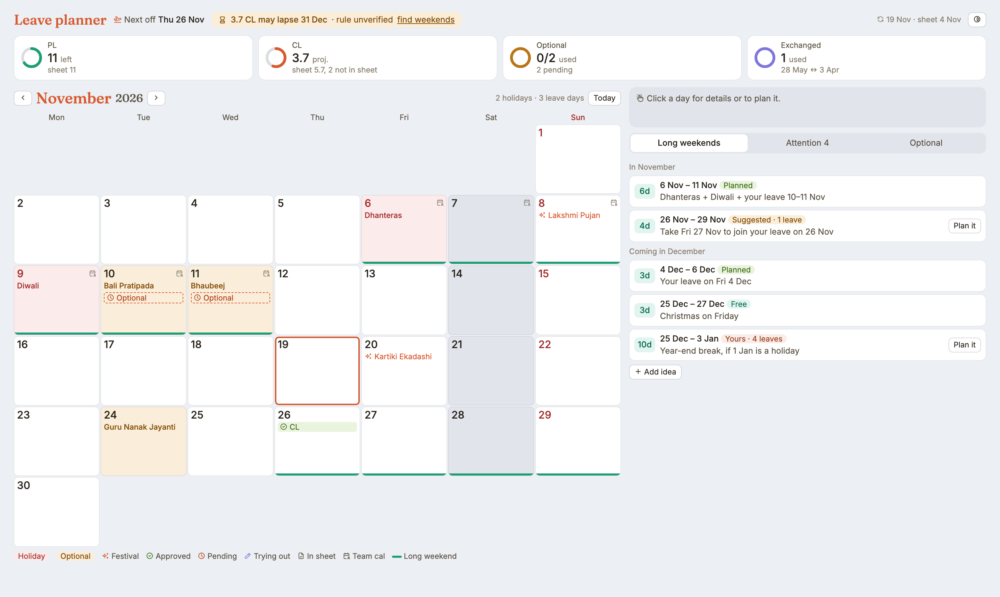

# Leave planner

A [Claude Code](https://claude.com/claude-code) skill that keeps a personal leave dashboard
up to date. It reads your company's leave sheet, your leave request emails and your team
calendar, then builds one HTML page you open in a browser.



*The screenshot uses the sample data in [`examples/demo-data`](examples/demo-data).*

## What the dashboard shows

- **Balances:** PL and CL left, projected after leaves that are approved but not yet in the HR
  sheet, optional holidays used, and holidays you worked in exchange for another day off.
- **Month calendar** in the style of a Marathi Kalnirnay wall calendar: company holidays in red,
  optional holidays in amber, festivals, your approved and pending leaves, and which days are
  already on the team calendar and in the HR sheet.
- **Long weekends** for this month and next: ones you get free, ones your leaves already make,
  and suggestions like "take Fri 27 to join your leave on Thu 26". You can add your own ideas.
- **Attention:** places where the sheet, the emails and the team calendar disagree, for example
  an approved leave missing from the team calendar, or a request with no reply for a week.
- **Optional holidays** with what you've used and what's still available.
- **Try out plans:** click "Plan it" on a long weekend or "Plan this day" on a date to see your
  balances change, then copy a command that drafts the request email.
- A warning when CL may lapse at the end of the year. Light and dark themes.

## How it works

```
Google Drive (HR sheet) ─┐
Gmail (leave threads)  ──┼─► Claude Code fetches with connectors ─► data/*.json ─► build.py ─► leave-dashboard.html
Google Calendar        ──┘        (only what changed since last run)
```

- **`skill/SKILL.md`** tells Claude how to fetch and parse each source, and the rules it must
  follow: the HR sheet is read-only, emails are only ever drafted (never sent), and team
  calendar changes need your approval each time.
- **`skill/build.py`** is plain Python 3 with no dependencies and no network access. It turns
  the JSON into the page, works out balances, long weekends and mismatches.
- **`skill/template.html`** is the page itself: vanilla JavaScript, no build step.
- Data that rarely changes (holidays, festivals, past years) is cached, so a refresh only
  re-reads what changed.

## Commands

| Command | What it does |
|---|---|
| `/leave-dashboard` | Refresh the data, rebuild the page, and report what changed |
| `/leave-dashboard request <dates> <type>` | Draft a leave request email to your manager (not sent) |
| `/leave-dashboard sync-calendar` | Propose team calendar entries to add or remove; applies only the ones you approve |
| `/leave-dashboard add-weekend <from> <to> [note]` | Save your own long-weekend idea |
| `leaves` (in any terminal) | Open the dashboard in your browser. Rebuilds from the saved data first, so "today" is current; it does not fetch anything new |

## Set up

You need Claude Code with the Google Drive, Gmail and Google Calendar connectors, and Python 3.

```bash
git clone https://github.com/amrakshay/leave-planner.git
cd leave-planner
./install.sh
cp examples/config.example.json config.json
```

`install.sh` links the skill into `~/.claude/skills/leave-dashboard` and adds a `leaves`
alias to your `~/.zshrc` (or bash profile). Pass a name to use another alias:
`./install.sh myleaves`. Running it again changes nothing.

Fill in `config.json` (your name, manager, the leave sheet's title, calendar IDs, Gmail
queries), then run `/leave-dashboard` in Claude Code. The skill asks for anything it can't find.

Try the page with sample data, no setup needed:

```bash
python3 skill/build.py --config examples/config.example.json --data examples/demo-data --out /tmp/leave-demo.html --today 2026-11-19 --no-write-weekends
```

```bash
open /tmp/leave-demo.html
```

## Your data stays local

`config.json`, `data/` and `leave-dashboard.html` are in `.gitignore`. Your name, manager,
sheet and calendar IDs and leave history never leave your machine through this repo. Only the
code and the sample data in `examples/` are committed.

## Adapting it to your company

The skill expects a yearly leave sheet with one row per person, leave requests sent by email
and approved by reply, and a shared calendar of holidays. If your company does it differently,
change the fetch steps in `skill/SKILL.md`; the JSON format in
[`skill/reference/data-format.md`](skill/reference/data-format.md) and `build.py` stay the same.
